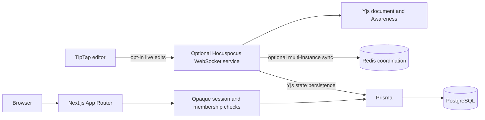

# Collabry

Collabry is a collaborative workspace and document editing application. Teams can organize workspaces, manage member roles, and create rich-text documents with comments and version history. The repository also includes an optional Yjs and Hocuspocus collaboration service for live editing and presence, coordinated across instances by Redis.

> **Verification status:** Core application logic, UI, and collaboration behavior have local test coverage. PostgreSQL-backed integration, live multi-browser collaboration, and production deployment have not been verified. Keep the collaboration flag disabled in production until those checks are complete.

## The problem and approach

Teams need a shared place to draft documents and discuss changes without losing track of access or edits. Collabry combines authenticated workspaces, role-aware document access, a TipTap editor, comments, and revision-checked saves. Its optional collaboration path uses Yjs to merge concurrent document edits and Hocuspocus to communicate updates over WebSockets.

## Features

- Registration and login with bcrypt-hashed passwords and opaque database-backed sessions.
- Personal and shared workspaces, documents, dashboard search, and recently opened documents.
- Server-enforced `OWNER`, `EDITOR`, `COMMENTER`, and `VIEWER` access policies.
- TipTap rich-text editing with bounded JSON validation and revision checks to reject stale saves.
- Comments with role checks, resolve/reopen behavior, and author-only deletion.
- Labeled JSON document snapshots and restore logic, covered by unit tests. The version-history migration must be applied to a database before those routes can be used there.
- Optional Yjs/Hocuspocus editing, authenticated presence, single-use collaboration tickets, and Redis coordination code.

The Yjs/Hocuspocus path is opt-in and is not production-ready: PostgreSQL persistence and two-browser editing have not been integration-tested, and the WebSocket service has not been deployed. A previous two-instance Redis test passed locally with in-memory persistence; it did not verify PostgreSQL durability or production behavior.

## Technology

- Next.js App Router and React
- TypeScript
- Prisma ORM and PostgreSQL
- TipTap / ProseMirror
- Yjs CRDT documents and Hocuspocus WebSockets (optional collaboration path)
- Redis Pub/Sub and coordination (multi-instance collaboration only)
- Zod validation and Node.js test runner

## Architecture



### Yjs and conflict resolution

Yjs represents shared document edits as CRDT updates. Concurrent edits can be merged without choosing one user's entire document as the winner. In Collabry's optional path, TipTap binds to a Yjs document, the Hocuspocus provider sends updates over WebSockets, and server-side authorization checks access before collaboration tickets and connections are accepted. Awareness carries ephemeral presence data such as user identity and cursor position; it is separate from saved document state.

The current conventional editor path saves validated TipTap JSON through HTTP with a document revision. The Yjs and WebSocket path is implemented but its database durability and browser-to-browser behavior remain unverified. A provider synchronization event is not treated as a PostgreSQL durability acknowledgement.

### Redis and multiple collaboration instances

The official Hocuspocus Redis extension is used to propagate Yjs document updates and awareness between service instances and coordinate its store hook. Redis is not the document database; PostgreSQL is intended to persist Yjs state. Redis Pub/Sub is not durable, so a successful Redis test with in-memory persistence does not prove database durability. Use a private TLS Redis endpoint for remote services. Keep collaboration disabled in production until the separate WebSocket service, PostgreSQL persistence, Redis behavior, and browser clients are verified.

### Authentication and authorization

Passwords are bcrypt-hashed. Session tokens are random opaque values stored as SHA-256 hashes and delivered in an `httpOnly`, `SameSite=Lax` cookie (`Secure` in production). API handlers validate input and enforce workspace membership and role permissions on the server. Nonmembers do not receive protected workspace or document data. The final workspace owner cannot be demoted or removed.

## Project layout

```text
src/app/                 Next.js pages and API routes
src/collaboration/       Hocuspocus, Yjs, presence, and Redis integration
src/lib/                 Authentication, persistence, validation, and domain logic
prisma/                  Prisma schema and checked-in migrations
tests/                   Offline unit tests and opt-in integration tests
docs/                    API, deployment, and collaboration guides
internship-submission/   Project, test, presentation, and demo handoff documents
public/                  Static assets and local font files
```

## Requirements

- Node.js 20.19 or newer (an active supported LTS release is recommended)
- npm 10 or newer
- PostgreSQL 15 or newer for running the application
- Redis only for multi-instance collaboration

## Run locally

1. Install PostgreSQL and create a new, empty local development database. Use a disposable local database, not production data.
2. From the repository root, create a local environment file from the template:

   ```powershell
   Copy-Item .env.example .env
   ```

3. Configure the required variable names in `.env`:

   - `DATABASE_URL`: PostgreSQL URL used by the application.
   - `DATABASE_URL_UNPOOLED`: direct PostgreSQL URL used by Prisma CLI migrations. It may match `DATABASE_URL` for a local database.
   - `NEXT_PUBLIC_COLLABORATION_ENABLED`: set to `false` for the standard application setup.

   Do not commit `.env` or share connection strings. `.env.example` contains placeholders only.

4. Install dependencies, generate Prisma Client, and apply checked-in migrations to the confirmed local database:

   ```powershell
   npm ci
   npm run db:generate
   npm run db:migrate:deploy
   ```

   Confirm the target is the intended local development database before applying migrations. `npm run db:migrate` is a development-only Prisma command that may create a migration; it is not the normal setup command.

5. Start the application:

   ```powershell
   npm run dev
   ```

6. Visit `http://localhost:3000`, register a disposable test account, and create a workspace and document.

### Optional collaboration service

The normal application runs with collaboration disabled. To experiment with the separate Hocuspocus process, configure the local app and server with the appropriate environment variable names: `NEXT_PUBLIC_COLLABORATION_ENABLED`, `NEXT_PUBLIC_COLLABORATION_URL`, `COLLABORATION_PORT`, `COLLABORATION_HOST`, `COLLABORATION_ALLOWED_ORIGINS`, and the database variables above. Start the Next.js app and the WebSocket service in separate terminals (`npm run dev` and `npm run dev:collab`).

`COLLABORATION_REDIS_URL` and `COLLABORATION_REDIS_REQUIRED` are for multi-instance service coordination; a single local instance does not need Redis. Follow [the Redis service guide](docs/COLLABORATION-REDIS.md) for its test setup. This optional service is experimental: do not enable it in production based on local unit or in-memory Redis results alone.

`COLLABORATION_TEST_DATABASE_URL` and `COLLABORATION_TEST_REDIS_URL` are for their respective opt-in integration tests only. They are not needed to run the app or the default offline suite. The PostgreSQL integration URL is restricted by the repository's validator to its dedicated test target.

## Checks and test evidence

Run the local checks from PowerShell:

```powershell
npm.cmd test
npx.cmd tsc --noEmit
npx.cmd eslint src tests
npx.cmd prisma validate
npm.cmd run build
git diff --check
```

On 2 November 2026, the offline suite passed **125 tests** (including nine URL-validator tests), and TypeScript, targeted ESLint, Prisma schema validation, production build, and `git diff --check` passed. The local Node 24 host required a process-only user-info workaround for the test runner; that machine-specific helper is not part of the project release. The checks did not connect to a database.

PostgreSQL integration tests are opt-in and were not run. The Redis two-instance integration passed in an earlier local run using in-memory document persistence; it was not rerun for this handoff. Neither result verifies PostgreSQL durability, real-browser end-to-end behavior, or a deployed service. See the [test report](internship-submission/TEST-REPORT.md) for exact scope and limitations.

## Demo and assets

A logo asset is included; no verified product screenshots or production demo URL are included in this handoff.


Use the [demo script](internship-submission/DEMO-SCRIPT.md) for a local workflow. Demonstrating persistence requires a configured local database. Do not describe database-backed collaboration as verified based only on unit tests.

## Deployment

The [Vercel and PostgreSQL deployment guide](docs/DEPLOYMENT.md) is a setup checklist, not evidence of a live deployment. Production requires reviewed environment configuration and an intended PostgreSQL database. This handoff did not apply production migrations or deploy the app. The Hocuspocus process is separate from the Next.js deployment and should remain disabled in production until its database persistence, Redis coordination, and browser behavior are verified.

## Internship submission

- [Project report](internship-submission/PROJECT-REPORT.md)
- [Test and verification report](internship-submission/TEST-REPORT.md)
- [Architecture, data model, and API documentation (Markdown)](internship-submission/ARCHITECTURE-DATA-API-DOCUMENTATION.md)
- [Architecture, data model, and API documentation (PDF)](internship-submission/ARCHITECTURE-DATA-API-DOCUMENTATION.pdf)
- [10-minute presentation (PowerPoint)](internship-submission/PRESENTATION.pptx)
- [Presentation speaker notes](internship-submission/PRESENTATION-SPEAKER-NOTES.md)
- [Presentation outline](internship-submission/PRESENTATION.md)
- [Demo walkthrough](internship-submission/DEMO-SCRIPT.md)
- [Individual reflection](internship-submission/INDIVIDUAL-REFLECTION.md)

## Known limitations and future work

- PostgreSQL-backed persistence and the version-history migration have not been integration-tested; the version migration remains unapplied.
- The optional WebSocket service is not deployed, and two-browser editing is unverified.
- Redis coordination has historical local test evidence with in-memory persistence only.
- Workspace/document deletion, invitations, email verification, password reset, and rate limiting are not implemented.
- No performance results or production smoke-test results are available.

Potential next work includes database-backed integration coverage, browser-based collaboration verification, a separate secure WebSocket deployment, performance testing, and the missing account/workspace workflows.

## Contribution and license

No contribution process or license file is currently included. Confirm project ownership and add an appropriate license before redistributing the code.
