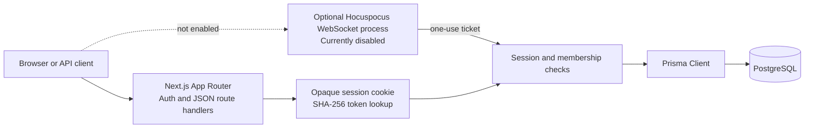

# Collab Space
Collab Space is an early-stage Next.js App Router project with account registration and login, opaque database-backed sessions, workspace management, and a persistent TipTap document editor. Rich-text content is saved as validated JSON with revision checks. TipTap/Yjs/Hocuspocus integration code is present, but collaboration is currently disabled in every environment pending safe persistence-failure reporting and integration tests.

## Status

Implemented in source:

- Registration creates a user, owner membership, starter workspace, and starter document in a database transaction.
- Login/logout use a 30-day `httpOnly`, `SameSite=Lax` cookie. Session tokens are random 256-bit values; only SHA-256 hashes are stored. Passwords are bcrypt-hashed, and both registration and login reject values longer than bcrypt's 72-byte UTF-8 input limit.
- Workspace listing/creation and document list/create/read/rename APIs require an authenticated user. Membership is checked for workspace/document reads and writes; nonmembers receive not-found responses.
- The dashboard restores sessions, lists workspaces, and links to individual document pages.
- The TipTap editor supports basic formatting and persists rich-text JSON through a bounded, validated endpoint. Content revisions reject stale writes; owner/editor roles can edit, commenter roles can comment, and viewer roles are read-only.
- Comments are implemented: workspace members can read them, owner/editor/commenter roles can create and resolve them, and authors can delete their own comments.
- Workspace member lists are visible to members. Owners can change non-owner roles or remove members; the last owner cannot be demoted or removed.
- API JSON is validated with Zod. Unexpected errors handled by the shared wrapper return generic JSON responses.
- A PostgreSQL Prisma schema and additive migrations are included. `Document.yState` remains reserved for Yjs updates.
- Collaboration ticket issuance and Hocuspocus authentication logic are implemented, but the endpoint and server hooks are currently disabled by the fail-closed operational readiness gate.

Not implemented (do not treat as available):

- The TipTap editor/provider client and Hocuspocus Yjs persistence hooks are present, but the operational gate currently keeps collaboration disabled in every environment. Hocuspocus v3.1.1 detaches debounced store failures from the document-update callback, so a failed write cannot be reliably surfaced to the editor without a safe lifecycle integration. Provider synchronization is not a durability acknowledgement; database persistence and two-browser synchronization have not been integration-tested.
- Version snapshots/history are not implemented; the history dialog reports that it is unavailable, and no version endpoints or restore UI are available.
- There are no workspace/document delete endpoints, email invitation flow, rate limiting, or automated database integration tests.

## Requirements

- Node.js 20.19+ recommended (use an active supported Node.js LTS).
- npm 10+.
- PostgreSQL 15+ for a live local demonstration.
- Git and a terminal; on Windows, the commands below work in PowerShell.

## Local Setup

The app requires PostgreSQL at runtime. These steps are for an isolated, local, test-only database; do not point the app at production or any database you are not authorized to use.

1. Install Node.js and npm, then install PostgreSQL 15 or newer. Start the local PostgreSQL service.
2. Create a **new empty** database named `collab_space` using pgAdmin or your local PostgreSQL administrator. Use a local least-privilege account where practical.
3. From the repository root, copy the committed environment template and edit the local copy:

   ```powershell
   Copy-Item .env.example .env
   ```

   Update only your local `.env` so `DATABASE_URL` matches your local PostgreSQL host, port, database name, username, and password. The template is an example, not a guaranteed match for your installation. Keep credentials out of source control and logs; `.env` is ignored by Git.

4. Install locked dependencies, generate Prisma Client, and then apply the checked-in migration history:

   ```powershell
   npm ci
   npm run db:generate
   npm run db:migrate:deploy
   ```

   Only run the migration step after database use is approved and you have confirmed `DATABASE_URL` points to the intended local test database. Prisma applies the checked-in migrations in order; do not execute SQL files manually. `npm run db:migrate` is a development-only `prisma migrate dev --name init` command that can create a new migration; it is not the setup/deploy command for this repository.

5. Start the Next.js app:

   ```powershell
   npm run dev
   ```

6. Open `http://localhost:3000` and register a test account. Registration creates a personal workspace, owner membership, and starter document.

### Demonstration flow

1. Sign up, then refresh the dashboard to demonstrate session restoration.
2. Create a workspace and a titled document; open it and edit the title and formatted content.
3. Wait for **All changes saved**, refresh the document, and confirm the title/content remain. This demonstrates the HTTP JSON autosave path against the configured database.
4. Add, resolve, and delete a comment. Use dashboard search, open the document from Recent documents, and inspect workspace Access.
5. Open History to see the explicit unavailable state; version history is not implemented.
6. A new account initially has only its own workspace. Invitations are not implemented, so demonstrating multiple roles/member changes requires a second test user and membership provisioned through a separately approved method; no provisioning flow is included here.

Database setup, migrations, and live save/reload are not covered by automated unit tests. Without an approved local database, demonstrate only the build and isolated tests; do not claim persistence was verified.

## Environment Variables

| Variable | Required | Description |
| --- | --- | --- |
| `DATABASE_URL` | Yes | PostgreSQL connection string, e.g. `postgresql://postgres:<password>@localhost:5432/collab_space?schema=public`. Use a least-privilege application account outside local development. |
| `COLLABORATION_PORT` | For `dev:collab` | WebSocket server port (1-65535). |
| `COLLABORATION_ALLOWED_ORIGINS` | For `dev:collab` | Comma-separated exact browser origins; HTTPS in production, loopback HTTP for local development. Wildcards and paths are rejected. |
| `COLLABORATION_HOST` | No | Bind address for the separate WebSocket process; defaults to `127.0.0.1`. |
| `NEXT_PUBLIC_COLLABORATION_ENABLED` | No | Defaults to `false`. The editor, ticket API, JSON-write guard, and Hocuspocus server require exact `NODE_ENV=development` and this explicit flag, but an additional fail-closed readiness gate currently keeps collaboration disabled in every environment. |
| `NEXT_PUBLIC_COLLABORATION_URL` | When collaboration is enabled | Hocuspocus WebSocket URL. Use a local `ws://` address only for local development; the value is not a credential. |

`.env*` files are ignored by Git; `.env.example` is the only committed environment template. Use a secret manager in production. Require TLS for remote PostgreSQL and restrict network access to the application. Collaboration variables are optional for the current app because real-time collaboration is disabled.

## Architecture



The existing TipTap JSON autosave remains the active content path. Collaboration configuration accepts only exact `NODE_ENV=development` plus an explicit `"true"` opt-in, but the operational readiness gate currently disables the editor, ticket endpoint, JSON-write guard, and server hooks in all environments. This fail-closed state is required because Hocuspocus v3.1.1 does not await debounced persistence failures from its document-update callback; those failures cannot currently be presented as durable-save status. Migration application status is unknown and must be explicitly verified before any future activation. Two-browser and database integration tests are still required. The persistence design assumes one collaboration-server process per document; no Redis/shared-document coordination or active-socket revocation mechanism is configured.

Do not enable collaboration or remove the operational readiness gate until Hocuspocus persistence failures can be reliably observed without detached rejections, the required migration has been explicitly approved and confirmed applied, and database and two-client integration tests have passed. The configured flag alone does not activate collaboration. Do not expose tickets in URLs or logs.

## Authorization

Each protected route resolves the opaque cookie to a non-expired session, then verifies workspace membership. Workspace creation atomically inserts the owner membership and a starter document. Current write policy:

| Role | Read workspace documents | Create/rename/edit documents | Comment and resolve | Manage members |
| --- | --- | --- | --- | --- |
| Owner | Yes | Yes | Yes | Yes |
| Editor | Yes | Yes | Yes | No |
| Commenter | Yes | No | Yes | No |
| Viewer | Yes | No | No | No |

All permissions are enforced server-side. Members can read workspace members and document comments; only the comment author can delete their comment. Owners may manage roles/removals, subject to the last-owner protection.

## API

See [API documentation](docs/API.md) for endpoint payloads, responses, and limitations.

## Checks

Run the local gates:

```bash
npm run lint
npx tsc --noEmit
npm test
npm run build
```

The automated tests use isolated core logic, in-memory repositories, and local fixtures; they do not connect to PostgreSQL and do not establish real database behavior. TypeScript, lint, and build checks likewise do not run migrations or database-backed tests. Database integration and authenticated save/reload behavior must be demonstrated separately against an explicitly configured database.

## Deployment

- Deploy the Next.js application as a Node.js server; this is not a static export.
- Set `DATABASE_URL` in the hosting secret manager and run `npm run db:migrate:deploy` against the intended database before serving traffic.
- The supported setup runs the Next.js application only; Hocuspocus is not required and collaboration remains disabled. Do not start or expose a collaboration server as a working feature until its readiness gate and integration requirements have been resolved.
- If collaboration is explicitly approved and made ready in a future release, run the Next.js and Hocuspocus processes separately, configure `COLLABORATION_PORT` and an exact `COLLABORATION_ALLOWED_ORIGINS` allowlist, and terminate TLS at a trusted reverse proxy for production WebSocket connections.
- Use HTTPS so production session cookies have the `Secure` flag. Use a least-privilege database account with TLS.
- Use Node.js 20.19+ or a current LTS to avoid the local Node 20.16 engine warning.
- Back up PostgreSQL and verify restore procedures. Expired-session and collaboration-ticket cleanup jobs are not implemented.
- Horizontal scaling and active-socket authorization revocation are not configured. Collaboration and its persistence hooks are currently fail-closed in every environment; do not deploy this as a production collaborative editor.

## Presentation

See the [10-minute presentation outline](docs/PRESENTATION.md).

The easiest way to deploy your Next.js app is to use the [Vercel Platform](https://vercel.com/new?utm_medium=default-template&filter=next.js&utm_source=create-next-app&utm_campaign=create-next-app-readme) from the creators of Next.js.

Check out our [Next.js deployment documentation](https://nextjs.org/docs/app/building-your-application/deploying) for more details.
