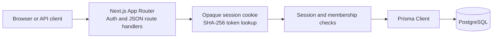

# Collab Space
Collab Space is an early-stage Next.js App Router project with account registration and login, opaque database-backed sessions, workspace management, and a persistent TipTap document editor. Rich-text content is saved as validated JSON with revision checks; realtime collaboration is not implemented.

## Status

Implemented in source:

- Registration creates a user, owner membership, starter workspace, and starter document in a database transaction.
- Login/logout use a 30-day `httpOnly`, `SameSite=Lax` cookie. Session tokens are random 256-bit values; only SHA-256 hashes are stored.
- Workspace listing/creation and document list/create/read/rename APIs require an authenticated user. Membership is checked for workspace/document reads and writes; nonmembers receive not-found responses.
- The dashboard restores sessions, lists workspaces, and links to individual document pages.
- The TipTap editor supports basic formatting and persists rich-text JSON through a bounded, validated endpoint. Content revisions reject stale writes; owner/editor roles can edit, while commenter/viewer roles are read-only.
- API JSON is validated with Zod. Unexpected errors handled by the shared wrapper return generic JSON responses.
- A PostgreSQL Prisma schema and additive migrations are included. `Document.yState` remains reserved for Yjs updates.

Not implemented (do not treat as available):

- There is no Yjs document provider/server, presence/cursor flow, collaboration-ticket endpoint, or realtime persistence path. Yjs and Hocuspocus packages are installed but not wired into the editor.
- Comments, snapshots/version history, and workspace role changes exist only as schema concepts. There are no endpoints or UI for them.
- There are no workspace/document delete endpoints, email invitation flow, rate limiting, or automated database integration tests.

## Requirements

- Node.js 20.19+ recommended. This project was checked with Node 20.16.0; builds pass there, but an ESLint transitive package warns that it requires Node 20.19+.
- PostgreSQL 15+.
- npm 10+.

## Local Setup

1. Create a PostgreSQL database named `collab_space` using pgAdmin or your PostgreSQL administrator account.
2. Copy `.env.example` to `.env` and replace `YOUR_LOCAL_PASSWORD` with your local PostgreSQL password. Never commit `.env` or paste credentials into issue trackers.
3. Install dependencies, generate Prisma Client, and apply the checked-in migrations:

	```bash
	npm install
	npm run db:generate
	npx prisma migrate deploy
	```

4. Start the Next.js development server:

	```bash
	npm run dev
	```

5. Visit `http://localhost:3000` to sign in, manage workspaces, and open documents in the editor.

`npm run db:migrate` is a development convenience (`prisma migrate dev --name init`). Use `npx prisma migrate deploy` in deployment environments.

## Environment Variables

| Variable | Required | Description |
| --- | --- | --- |
| `DATABASE_URL` | Yes | PostgreSQL connection string, e.g. `postgresql://postgres:<password>@localhost:5432/collab_space?schema=public`. Use a least-privilege application account outside local development. |

`.env*` files are ignored by Git; `.env.example` is the only committed environment template. Use a secret manager in production. Require TLS for remote PostgreSQL and restrict network access to the application.

## Architecture



The current data path is HTTP only. TipTap JSON is stored separately from `Document.yState`, which remains reserved for future Yjs collaboration. `Comment`, `DocumentVersion`, and `CollaborationTicket` are schema groundwork; there is no WebSocket process, presence flow, or Redis adapter.

## Authorization

Each protected route resolves the opaque cookie to a non-expired session, then verifies workspace membership. Workspace creation atomically inserts the owner membership and a starter document. Current write policy:

| Role | Read workspace documents | Create/rename/edit documents | Comment | Manage members |
| --- | --- | --- | --- | --- |
| Owner | Yes | Yes | Not implemented | Not implemented |
| Editor | Yes | Yes | Not implemented | Not implemented |
| Commenter | Yes | No | Not implemented | Not implemented |
| Viewer | Yes | No | Not implemented | Not implemented |

Comment/member permissions describe intended policy only; those APIs do not exist yet. Keep authorization server-side when implementing them.

## API

See [API documentation](docs/API.md) for endpoint payloads, responses, and limitations.

## Checks

Run the local gates:

```bash
npm run lint
npx tsc --noEmit
npm test
npx prisma validate
npm run build
npm audit --omit=dev
```

Verified in this workspace: TypeScript, ESLint, and all 6 unit tests passed; Prisma Client generation and migration status passed; the additive migration was applied without resetting the database. An authenticated browser smoke test verified content save/reload, stale-write rejection, and invalid-content rejection. Database integration tests are not part of the automated suite.

## Deployment

- Deploy the Next.js application as a Node.js server; this is not a static export.
- Set `DATABASE_URL` in the hosting secret manager and run `npx prisma migrate deploy` before serving traffic.
- Use HTTPS so production session cookies have the `Secure` flag. Use a least-privilege database account with TLS.
- Use Node.js 20.19+ or a current LTS to avoid the local Node 20.16 engine warning.
- Back up PostgreSQL and verify restore procedures. Expired-session and collaboration-ticket cleanup jobs are not implemented.
- Horizontal scaling and WebSocket persistence are not configured. Do not deploy this as a multi-instance collaborative editor.

## Presentation

See the [10-minute presentation outline](docs/PRESENTATION.md).
This is a [Next.js](https://nextjs.org) project bootstrapped with [`create-next-app`](https://nextjs.org/docs/app/api-reference/cli/create-next-app).

## Getting Started

First, run the development server:

```bash
npm run dev
# or
yarn dev
# or
pnpm dev
# or
bun dev
```

Open [http://localhost:3000](http://localhost:3000) with your browser to see the result.

You can start editing the page by modifying `app/page.tsx`. The page auto-updates as you edit the file.

This project uses [`next/font`](https://nextjs.org/docs/app/building-your-application/optimizing/fonts) to automatically optimize and load [Geist](https://vercel.com/font), a new font family for Vercel.

## Learn More

To learn more about Next.js, take a look at the following resources:

- [Next.js Documentation](https://nextjs.org/docs) - learn about Next.js features and API.
- [Learn Next.js](https://nextjs.org/learn) - an interactive Next.js tutorial.

You can check out [the Next.js GitHub repository](https://github.com/vercel/next.js) - your feedback and contributions are welcome!

## Deploy on Vercel

The easiest way to deploy your Next.js app is to use the [Vercel Platform](https://vercel.com/new?utm_medium=default-template&filter=next.js&utm_source=create-next-app&utm_campaign=create-next-app-readme) from the creators of Next.js.

Check out our [Next.js deployment documentation](https://nextjs.org/docs/app/building-your-application/deploying) for more details.
