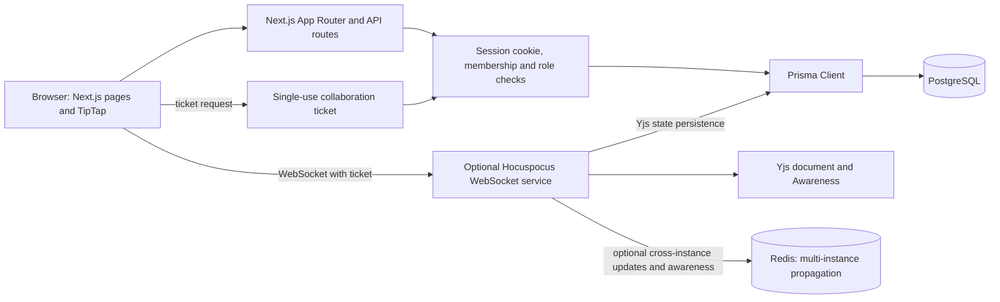

# Collabry Architecture, Data Model, and API

## Verification boundary

This document describes the checked-in implementation. The default test suite and production build pass locally, but no PostgreSQL integration, migration, production deployment, or browser-based two-user collaboration test has passed. The version-history migration is included but unapplied to the previously checked test database. Keep live collaboration disabled in production until its database persistence and WebSocket service are verified.

## System architecture

### Responsibilities

| Component | Responsibility |
| --- | --- |
| Next.js browser UI | Registration/login forms, dashboard, workspaces, document editing, comments, access controls, and optional collaboration client. |
| Next.js route handlers | Validate JSON inputs, resolve the session cookie, enforce workspace membership and role permissions, call domain/repository code, and return sanitized JSON errors. |
| Prisma/PostgreSQL | Store users, sessions, workspaces, memberships, documents, comments, version snapshots, and collaboration tickets. The database path has not been integration-tested in this handoff. |
| TipTap/ProseMirror | Render and edit supported rich-text JSON in the conventional HTTP-save path; bind to Yjs in the optional live collaboration path. |
| Hocuspocus | Separate long-running WebSocket process that authenticates one-use tickets, loads and stores Yjs state through the collaboration persistence hooks, publishes presence, and periodically rechecks connection authorization. |
| Redis extension | Optional multi-instance Yjs update and Awareness propagation plus store-hook coordination. Redis is not the durable document store. |

## User and document flows

### Authentication and authorization

1. Registration validates name, email, and password, including the bcrypt 72-byte UTF-8 limit.
2. The route hashes the password, then creates the user, personal workspace, owner membership, and starter document in a database transaction.
3. A random 256-bit session token is returned only in the `collab_session` cookie. PostgreSQL stores its SHA-256 hash with a 30-day expiry.
4. Protected API routes hash the cookie token for lookup, require an unexpired session, and check workspace membership before returning or changing protected records.
5. Role checks are server-side: Owner and Editor can edit documents; Owner, Editor, and Commenter can comment; Viewer is read-only. Only Owners manage memberships, and the final Owner cannot be demoted or removed.

Logout deletes the session row and expires the cookie. Collaboration connections carry session, user, workspace, and document identity in server-created context and revalidate access. A removed member, expired session, or demoted editor is disconnected by the collaboration authorization hooks.

### Conventional document editing

The document API returns validated TipTap JSON and a `contentRevision`. The editor sends JSON plus `expectedRevision` to the content endpoint. The server bounds and validates the supported document schema and uses compare-and-set revision updates. A stale write receives `409` and must reload rather than overwriting a concurrent save. This HTTP JSON path is the standard app path while live collaboration is disabled.

### Comments and version history

Workspace members can list comments. Owner, Editor, and Commenter can add, resolve, or reopen comments; only the author may delete a comment. Version history is explicit JSON snapshots, not a snapshot on every autosave. Owner and Editor can create and restore snapshots. Restore preserves the current content as `Before restore`, increments the revision, and guards against concurrent JSON/Yjs state changes. Version operations return `409` while live collaboration is configured because active documents are not yet coordinated with snapshot restore. The added `DocumentVersion.content` column requires the included migration before history routes work against a database.

## Real-time collaboration

The optional client creates a Yjs document and connects the Hocuspocus provider to the configured WebSocket URL. Before connection, the browser requests a short-lived, single-use ticket from the same-origin Next.js endpoint. The ticket is tied to the current session and document; only its hash is stored. Hocuspocus consumes it transactionally and checks that the session is active and the user remains an Owner or Editor of the document's workspace.

Yjs CRDT updates allow independent edits to converge without replacing the whole document with one user's copy. Hocuspocus carries updates over WebSockets. Awareness transports ephemeral presence such as collaborator identity and cursor/selection state; the server overwrites client-provided identity with the authenticated user's name and deterministic color. Presence is separate from persisted document data.

For multiple Hocuspocus instances, the official `@hocuspocus/extension-redis` publishes document updates and Awareness and coordinates the store hook. Redis Pub/Sub is not durable; PostgreSQL is intended to remain the persistence layer for encoded Yjs state. On Redis coordination errors, the implementation closes affected connections and rejects messages until coordination recovers. A previous local two-instance Redis run passed with in-memory document persistence; it did not verify PostgreSQL durability, a full Redis service outage, browser behavior, or deployment. No collaboration service is deployed.

## Data model

The following entities and fields reflect `prisma/schema.prisma`:

| Entity | Important fields | Relationships and constraints |
| --- | --- | --- |
| `User` | `id`, unique `email`, `name`, `passwordHash`, `createdAt` | Has sessions, memberships, created workspaces, comments, versions, and collaboration tickets. |
| `Session` | `id`, unique `tokenHash`, `userId`, `expiresAt`, `createdAt` | Belongs to User; indexed by `(userId, expiresAt)`; may be linked to collaboration tickets. |
| `Workspace` | `id`, `name`, `createdById`, timestamps | Belongs to its creator; has memberships and documents. |
| `WorkspaceMember` | `id`, `workspaceId`, `userId`, `role`, `createdAt` | Joins Workspace and User; unique `(workspaceId, userId)`; role is Owner, Editor, Commenter, or Viewer. |
| `Document` | `id`, `workspaceId`, `title`, nullable JSON `content`, `contentRevision`, nullable binary `yState`, timestamps | Belongs to Workspace; has comments, versions, and tickets; indexed by `(workspaceId, updatedAt)`. |
| `Comment` | `id`, `documentId`, `userId`, `text`, optional JSON `anchor`, `resolvedAt`, timestamps | Belongs to Document and author User; indexed by `(documentId, createdAt)`. |
| `DocumentVersion` | `id`, `documentId`, `userId`, `label`, nullable binary `yState`, nullable JSON `content`, `createdAt` | Belongs to Document and author User; indexed by `(documentId, createdAt)`. The additive migration makes legacy `yState` nullable and adds JSON `content`. |
| `CollaborationTicket` | `id`, unique `tokenHash`, `documentId`, `userId`, optional `sessionId`, `expiresAt`, `consumedAt`, `createdAt` | Belongs to Document and User, optionally Session; indexed by expiry and session. |

Prisma relations use cascading deletes. This schema description is static documentation, not evidence of a live database schema or migration state.

## API overview

All endpoints use JSON unless noted. Protected routes require the `collab_session` cookie. Typical errors are JSON `{ "error": "..." }`; unauthenticated requests return `401`, nonmembers are generally hidden with `404`, and insufficient roles receive `403`. Validation failures return `400`; stale revisions, duplicate registration, or forbidden concurrent operations use `409` where specified.

| Method and path | Purpose | Authorization / behavior |
| --- | --- | --- |
| `POST /api/auth/register` | Create account and starter workspace/document. | Public; `201`, validation `400`, duplicate email `409`. Sets session cookie. |
| `POST /api/auth/login` | Authenticate and set session cookie. | Public; invalid credentials `401`. |
| `POST /api/auth/logout` | Revoke session and clear cookie. | Uses current cookie; returns `{ "ok": true }`. |
| `GET /api/auth/me` | Return current public user. | Session required; otherwise `401`. |
| `GET /api/workspaces` | List caller's workspaces and summaries. | Session required; membership-scoped. |
| `POST /api/workspaces` | Create workspace, Owner membership, starter document. | Session required; `201`. |
| `GET /api/workspaces/{workspaceId}/documents` | List documents and caller role. | Workspace member; nonmember `404`. |
| `POST /api/workspaces/{workspaceId}/documents` | Create document. | Owner/Editor; title optional, defaults to `Untitled`; `201`. |
| `GET /api/workspaces/{workspaceId}/members` | List workspace member identities and roles. | Any workspace member; nonmember `404`. |
| `POST /api/workspaces/{workspaceId}/members` | Add an existing account by email and role. | Owner-only; no email invitation flow. |
| `PATCH /api/workspaces/{workspaceId}/members/{userId}` | Change a member role. | Owner-only; cannot grant Owner or demote last Owner. |
| `DELETE /api/workspaces/{workspaceId}/members/{userId}` | Remove a member. | Owner-only; cannot remove last Owner. |
| `GET /api/documents/{documentId}` | Read document, content revision, workspace and caller context. | Workspace member; raw Yjs state is not returned. |
| `PATCH /api/documents/{documentId}` | Rename document. | Owner/Editor. |
| `PUT /api/documents/{documentId}/content` | Save supported TipTap JSON with `expectedRevision`. | Owner/Editor; bounded payload; stale revision returns `409`. |
| `GET /api/documents/{documentId}/comments` | List recent comments. | Workspace member. |
| `POST /api/documents/{documentId}/comments` | Add comment. | Owner/Editor/Commenter; text length 1–2000. |
| `PATCH /api/documents/{documentId}/comments/{commentId}` | Resolve or reopen comment. | Owner/Editor/Commenter. |
| `DELETE /api/documents/{documentId}/comments/{commentId}` | Delete comment. | Author only. |
| `GET /api/documents/{documentId}/versions` | List JSON snapshot metadata. | Workspace member; needs migrated schema. |
| `POST /api/documents/{documentId}/versions` | Create labeled snapshot. | Owner/Editor; needs migrated schema; `409` during live collaboration or without valid JSON. |
| `POST /api/documents/{documentId}/versions/{versionId}/restore` | Restore snapshot and keep pre-restore content. | Owner/Editor; needs migrated schema; `409` on concurrent change or live collaboration. |
| `POST /api/documents/{documentId}/collaboration-ticket` | Issue single-use WebSocket ticket. | Same-origin request, session and Owner/Editor required; returns `503` when collaboration is disabled. |

Request examples and response details are maintained in [the API reference](../docs/API.md).

## Security and error handling

- Passwords are bcrypt-hashed; sessions and collaboration tickets are random tokens whose hashes are stored.
- Cookies are `httpOnly`, `SameSite=Lax`, path `/`, and `Secure` in production.
- API request bodies are validated with Zod or domain validators; document JSON has schema, size, and depth limits.
- Authentication and role checks run on the server; nonmember resources are concealed as not found.
- Unexpected API and collaboration failures suppress raw database credentials/tokens from responses and logs.
- The integration-test URL guard allowlists one dedicated test database and strict TLS parameters; its unit tests are offline and do not connect.
- `DATABASE_URL` is the runtime datasource; `DATABASE_URL_UNPOOLED` is Prisma CLI's direct URL. No secret values belong in source or this document.

## Local verification evidence

On 2 November 2026, the offline suite passed 125 tests after a machine-local Node 24 Windows user-info workaround. TypeScript, targeted ESLint, Prisma validation, production build, and `git diff --check` passed. PostgreSQL integration and migrations were not run. The earlier Redis integration used in-memory persistence. No performance measurement, browser end-to-end run, or production deployment has been verified; see [the test report](TEST-REPORT.md).
