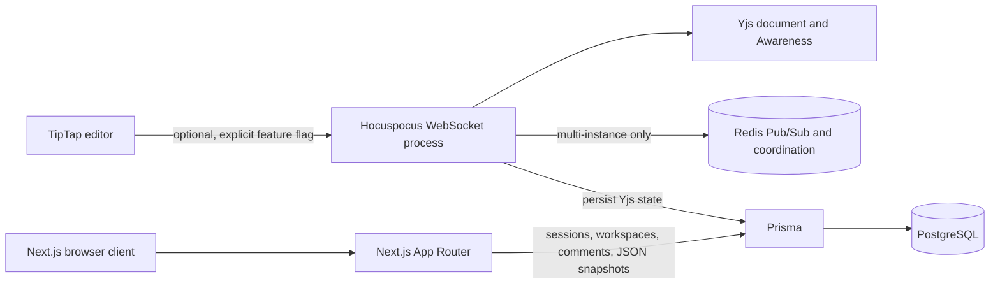

# Collabry Internship Project Report

## Summary

Collabry is a Next.js workspace and document application with authenticated accounts, role-aware access, a TipTap rich-text editor, comments, and explicit JSON version snapshots. The repository also contains an opt-in Yjs/Hocuspocus collaboration path with authenticated presence and an official Redis extension for coordinating multiple WebSocket instances.

This report describes repository implementation and local test evidence. A previous real Redis multi-instance run used local Memurai with in-memory document persistence; it was not rerun during this handoff. No PostgreSQL integration test, database migration, browser end-to-end run, or production deployment verification was performed. Keep real-time collaboration disabled in production.

## Requirements checklist

| Requirement | Repository status | Evidence / boundary |
| --- | --- | --- |
| Next.js application | Implemented | App Router, route handlers, authenticated pages |
| Workspaces and document pages | Implemented | Workspace/member/document routes and dashboard |
| Authentication | Implemented | Bcrypt passwords and database-backed opaque sessions; local tests |
| Rich-text editor | Implemented | TipTap JSON editor and bounded schema validation |
| Revision/conflict handling | Implemented | Compare-and-swap content updates; stale-write unit tests |
| Comments | Implemented | Read, create, resolve/reopen, author deletion; role tests |
| View/comment/edit permissions | Implemented server-side | Owner, Editor, Commenter, Viewer policies; route/core tests |
| Document history and restoration | Implemented in source | JSON snapshots and atomic restore logic; Prisma migration is unapplied and no live DB verification was done |
| Yjs collaboration | Implemented behind opt-in | Hocuspocus server/client, Yjs persistence hooks; local WebSocket regression tests |
| Authenticated presence | Implemented and locally tested | Server-derived awareness identity, cursors, avatars/initials, online count, local join/leave/scope tests |
| Redis multi-instance coordination | Implemented; historical local integration passed | Official `@hocuspocus/extension-redis` 3.4.4; a previous real two-instance/WebSocket integration passed against loopback Memurai. It used in-memory persistence and simulated outage by disconnecting adapter sockets; it was not rerun during this handoff |
| Deployed real-time demo | Not delivered/verified | No WebSocket deployment or real-browser session was run |
| Performance measurements | Not collected | No meaningful latency/load result is available |
| Release delivery | Reported separately | This report records implementation and verification evidence; commit, push, and deployment outcomes are reported separately |
| Architecture/API docs | Prepared | `docs/API.md`, `docs/COLLABORATION-REDIS.md`, and this report |
| Presentation and reflection | Prepared as drafts | Presentation outline and reflection prompts; reflection needs the intern's personal experience |

## Architecture

The conventional editor flow saves validated TipTap JSON using a document revision. The optional collaborative path uses short-lived one-use tickets, Hocuspocus, Yjs updates and Awareness, and persists encoded Yjs state in `Document.yState`. Redis propagates updates and awareness among server instances; it is not a document database. Workspace and document authorization remains in server hooks.

## Data and API

The Prisma schema models users, sessions, workspaces, memberships, documents, comments, collaboration tickets, and document versions. See [API documentation](../docs/API.md) for endpoint payloads and role behavior. The version-history migration adds JSON snapshot storage while retaining legacy binary Yjs snapshots. It has not been applied; the routes require that migration on the database they use.

## Security notes

- Session tokens are random and only their SHA-256 digests are stored.
- Passwords are bcrypt-hashed; input is limited to bcrypt's 72-byte UTF-8 boundary.
- API access checks run on the server and hide non-member documents as not found.
- Collaboration tickets are single-use, short-lived, document- and session-bound; tokens are not put in presence state.
- Awareness identity is derived from the authenticated server connection.
- Redis URLs for remote use must use TLS; Redis outages close active collaboration sockets and gate incoming messages.
- The client feature flag defaults off. Production activation is not warranted until the WebSocket deployment, persistence, and cross-instance behavior have passed verification.

## Verification snapshot

On 2 November 2026, `npm.cmd test` passed 125 tests after applying the repository's existing Node user-info preload workaround in that process; 9 tests cover the URL guard offline. `npx.cmd tsc --noEmit`, targeted ESLint (`src` and `tests`), Prisma schema validation, production build, and `git diff --check` passed. No database connection was made by these checks. The Redis two-instance integration was not run during this handoff; its earlier pass used in-memory persistence. See [test report](TEST-REPORT.md) for scope and limits.

## Known verification limits

- PostgreSQL-backed persistence and version-history integration have not been verified; the version-history migration is unapplied.
- The prior Redis test used in-memory persistence and is not evidence of PostgreSQL durability or deployment readiness.
- The separate WebSocket service, browser-based two-user editing, production deployment, performance, and screen recording have not been verified or delivered.
- The personal reflection remains a draft prompt and requires the intern's own experience if a completed reflection is required.
